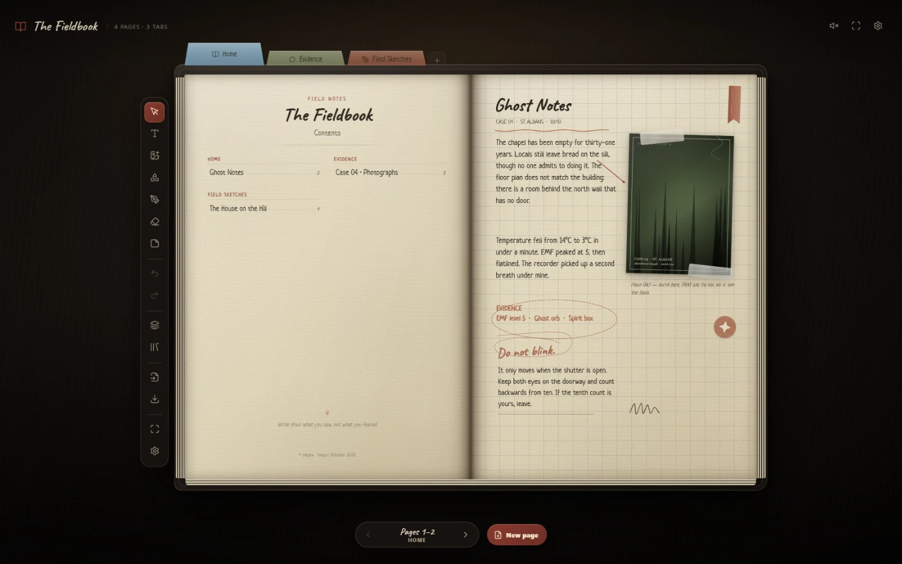
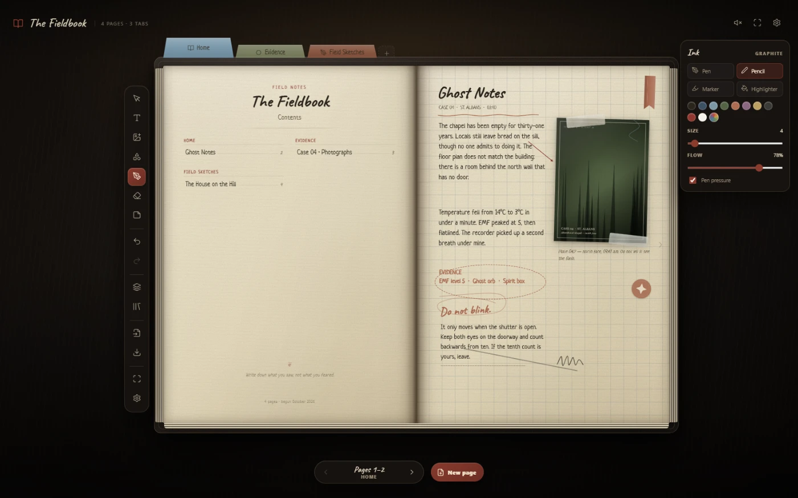
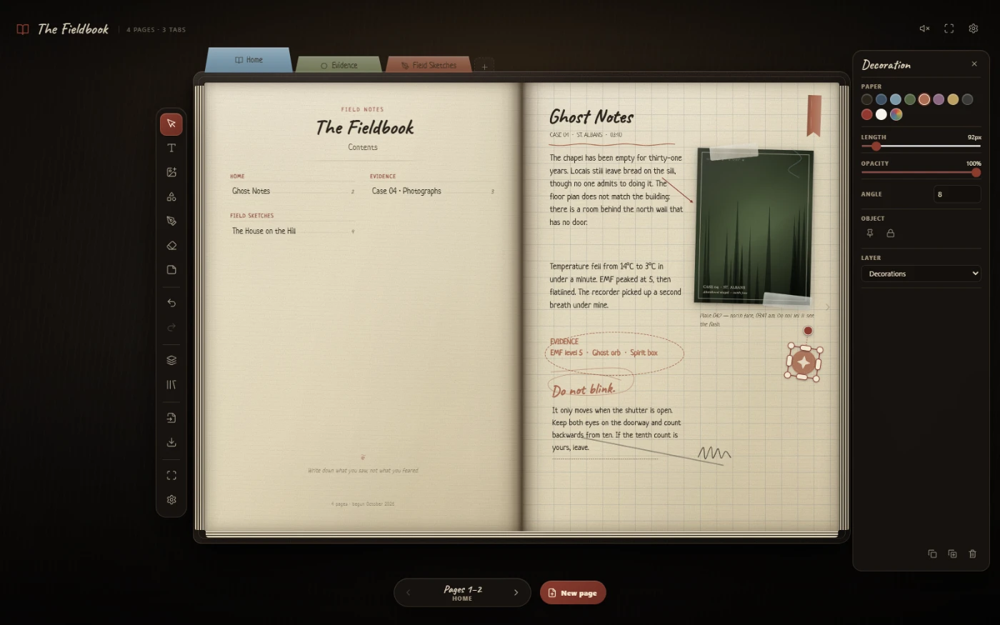
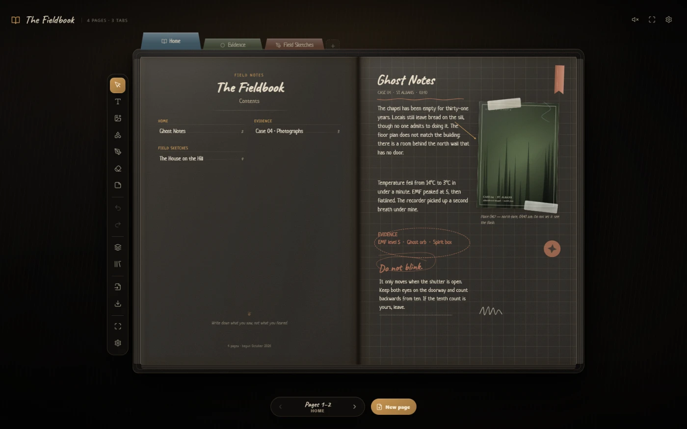
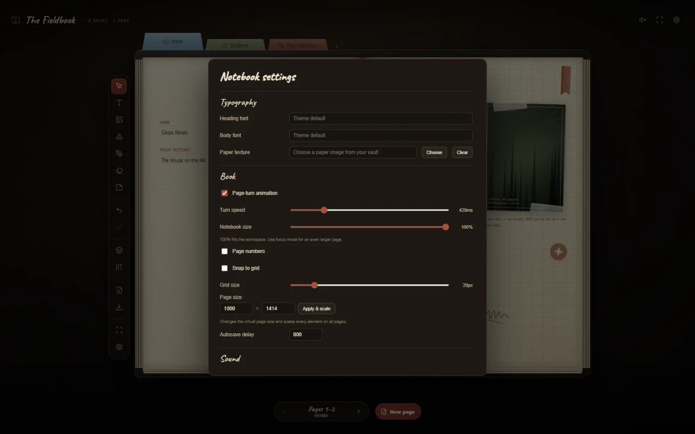
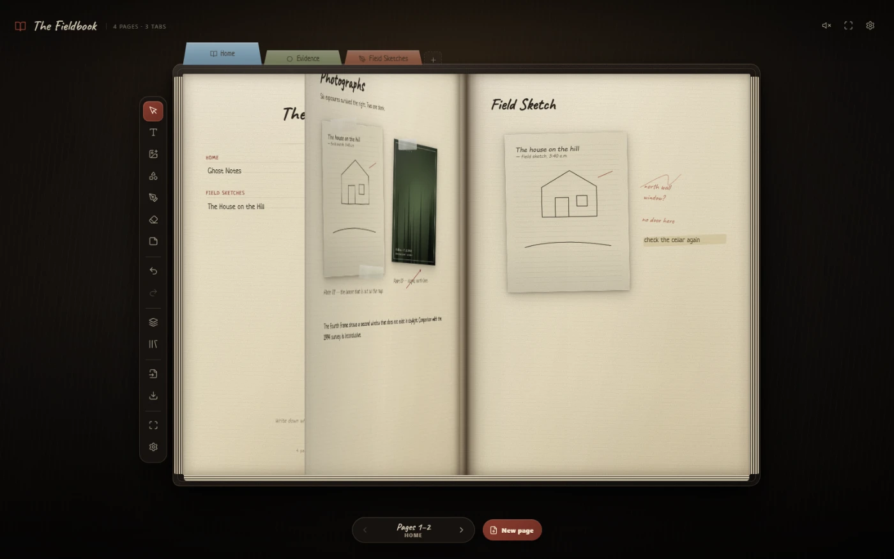

<div align="center">
  
  <h1>Fieldbook</h1>
  <p><strong>A real paper notebook inside Obsidian.</strong><br>
  A two-page spread, live ink, taped photographs, bookmarks, layers and page-turn sounds.</p>
  <p>
    <strong>English</strong> · <a href="README.md">Русский</a>
  </p>
  <p>
    
    
    
  </p>
</div>

## About

Fieldbook is not another blank canvas. It is a physical notebook that sits on your Obsidian desk: pages live in a two-page spread, turn in perspective with a paper sound, and make writing, typing, photographs and decorations feel like working with paper.

Everything stays local in your vault: no cloud, no account and no background requests. The plugin is desktop-only.

## Features

- **A real book spread.** Two pages, a spine, a cover and a 3D page turn. Turn speed is adjustable and `prefers-reduced-motion` disables the animation.
- **Live writing.** Pen, pencil, marker and highlighter with pressure support, a stroke eraser and separate ink layers.
- **Real paper.** Grain, lighting, a curved gutter and ruled, grid or dot layouts. Any image in your vault can become the paper texture; ink automatically adapts to light or dark paper.
- **Photographs and ephemera.** Insert from a file, the clipboard or drag-and-drop; crop, tape, photo corners, stickers, bookmarks, frames and highlight strips.
- **Bookmarks on top.** Tabs with icons and colours (Cream, Ocean, Sage, Rust, Plum, Gold, Charcoal, Rose), reorderable by dragging.
- **Structure.** A page manager, trash, a contents page and page moves between tabs.
- **Sound.** A recorded page turn, a real pencil-on-paper loop, quiet typing and per-category volumes. Every sound can be replaced with your own file.
- **Themes and typography.** Classic Journal, Old Manuscript, Clean Paper, Dark Journal and Field Research; handwritten Caveat and Neucha plus system fonts for headings and body text.
- **Sizes.** A virtual page format (A5-like by default) and an on-screen notebook size from 50% to 100% of the workspace.
- **Export.** Page to PNG, page to Markdown and Markdown import split across pages.
- **Focus mode.** The notebook takes over the window without Obsidian panels; leave with `Esc`.

## Screenshots

| Drawing tools | Colours, materials and the inspector |
| :---: | :---: |
|  |  |

| Dark paper | Notebook settings |
| :---: | :---: |
|  |  |



## Installation

Requires Obsidian 1.5.0 or newer, desktop only.

1. Clone the repository into your vault's plugin folder:

   ```bash
   git clone https://github.com/ZekiTRR/FieldBook.git <vault>/.obsidian/plugins/fieldbook
   ```

2. Enable the plugin: **Settings → Community plugins → Fieldbook**.
3. Open the notebook with the `Fieldbook: Open notebook` command or from the ribbon.

The repository ships the built `main.js` and `styles.css`, so no build step is needed for installation.

## Usage

- `V` selects, `T` creates text, `P` draws and `E` erases. Tools live on the left rail; the palette and brush settings live in the right-hand dock.
- Double-click a page to start a text block. Drag photographs onto a page or paste them from the clipboard.
- Right-click or double-click a top tab for rename, **Tab colour**, icon and new page. Tab colours apply instantly.
- The gear button opens notebook settings: theme, fonts, paper, size, sound and turn speed.
- `Ctrl/Cmd+Z` and `Ctrl/Cmd+Shift+Z` undo and redo. History lives for the lifetime of the Obsidian tab.

## Settings

- **Notebook.** Theme, heading and body fonts, paper texture.
- **Book.** Page-turn animation and speed, on-screen notebook size, page numbers, snap to grid, virtual page size, autosave delay.
- **Sound.** Global sound, volume, keyboard writing sound, page-turn recording and per-category volumes: Page turns, Tabs, Pen & pencil, Photos & tape, Interface.
- **Page.** Background for new pages (plain, ruled, grid, dots), contents, size.
- **Tabs.** Colour and icon for every bookmark.

## Data on disk

By default the notebook lives in a `Fieldbook/` folder in your vault:

```text
Fieldbook/
├── journal.json      # tabs, page order, settings
├── pages/            # one JSON file per page
├── attachments/      # photographs and imported sounds
└── exports/          # Markdown and PNG exports
```

Every save keeps a `.bak` copy next to the file; if a JSON file cannot be read, Fieldbook recovers it from the backup. The folder can be changed in the plugin settings.

## Development

```bash
npm install
npm run dev       # watch build
npm run build     # typecheck + production
npm run typecheck
```

The build writes `main.js` and `styles.css` to the plugin root. Local `data.json`, `node_modules` and source maps are not committed.

The plugin is written in TypeScript and uses only the Obsidian API, Canvas 2D and Web Audio. There is no backend and no network traffic at runtime.

## Credits

- Pencil sound: [Pencil #1](https://bigsoundbank.com/pencil-s0221.html) by Joseph SARDIN, BigSoundBank, CC0.
- Fonts: [Caveat](https://fonts.google.com/specimen/Caveat) and [Neucha](https://fonts.google.com/specimen/Neucha), SIL Open Font License 1.1. Licence texts are in `assets/fonts/`.
- Built on the [Obsidian API](https://docs.obsidian.md/). Not affiliated with Obsidian.

## License

MIT. See [LICENSE](LICENSE).
