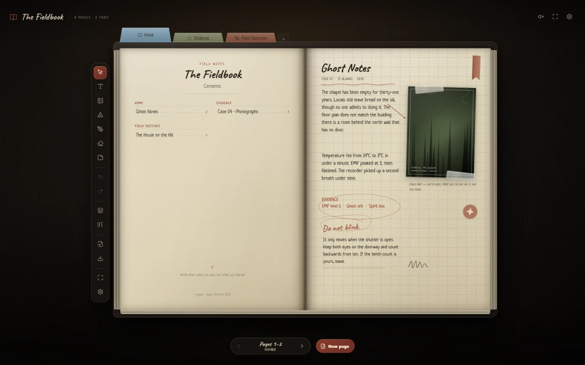
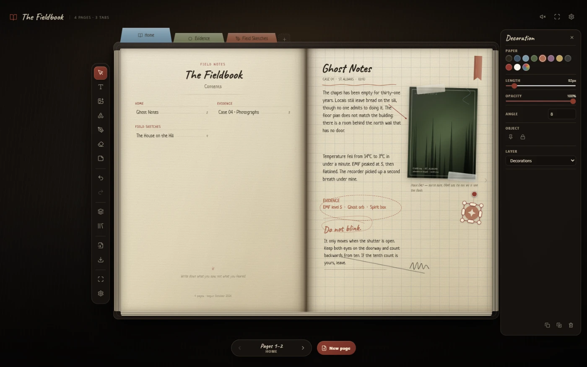
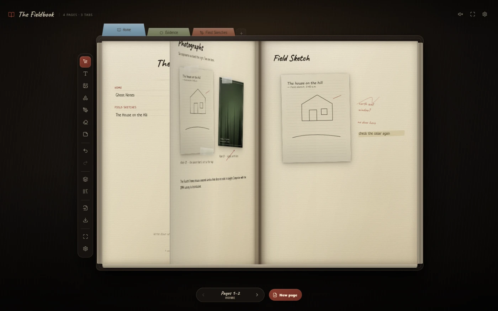

# Fieldbook

**A real paper notebook inside Obsidian.** A two-page spread, live ink, taped photographs, bookmarks, layers and page-turn sounds.

English · [Русский](README.ru.md)

[](https://github.com/ZekiTRR/FieldBook)
[](https://github.com/ZekiTRR/FieldBook)
[](LICENSE)

## About

Fieldbook is not another blank canvas. It is a physical notebook that sits on your Obsidian desk: pages live in a two-page spread, turn in perspective with a paper sound, and make writing, typing, photographs and decorations feel like working with paper.

Everything stays inside your vault. No cloud, no account, no payment and no network requests at runtime.

## Features

- **A real book spread.** Two pages, a spine, a cover and a 3D page turn. Turn speed is adjustable and `prefers-reduced-motion` disables the animation.
- **Live writing.** Pen, pencil, marker and highlighter with pressure support, a stroke eraser and separate ink layers.
- **Shape assist.** A "Straighten shapes" switch per tool in the dock: a shaky line becomes straight, a scribbled circle becomes an ellipse and a rough box becomes a rectangle. It is deliberately conservative — intentional curves stay untouched — and it turns off with one click.
- **Real paper.** Grain, lighting, a curved gutter and ruled, grid or dot layouts. Any image in your vault can become the paper texture; ink automatically adapts to light or dark paper.
- **Photographs and ephemera.** Insert from a file, the clipboard or drag-and-drop; crop, tape, photo corners, stickers, bookmarks, frames and highlight strips.
- **Dictaphone.** Press `R`, click where the note should live, and speak. The take becomes a strip of paper with a hand-drawn play ring, an ink waveform built from the real peaks and a handwritten duration. Tap the ring to play, tap the wave to jump, and choose tape, photo corners or bare paper in the inspector. Drag a corner to scale the whole strip up to three times its size — ring, bars, tape and handwriting grow together — or drag a side edge to widen only the waveform.
- **Bookmarks on top.** Tabs with icons and colours (Cream, Ocean, Sage, Rust, Plum, Gold, Charcoal, Rose), reorderable by dragging.
- **Structure.** A page manager, trash, a contents page and page moves between tabs.
- **Sound.** A recorded page turn, a real pencil-on-paper loop, quiet typing and per-category volumes. Every sound can be replaced with your own file.
- **Themes and typography.** Classic Journal, Old Manuscript, Clean Paper, Dark Journal and Field Research; handwritten Caveat and Neucha plus system fonts for headings and body text.
- **Sizes.** A virtual page format (A5-like by default) and an on-screen notebook size from 50% to 100% of the workspace.
- **Flexible storage.** Separate settings for the notebook folder, the attachments folder (photos, pasted images, sounds) and the exports folder — inside the notebook or anywhere in the vault.
- **Export.** Page to PNG, page to Markdown and Markdown import split across pages.
- **Focus mode.** The notebook takes over the window without Obsidian panels; leave with `Esc`.

## Screenshots

| Drawing tools | Colours, materials and the inspector |
| :---: | :---: |
|  |  |

| Dark paper | Notebook settings |
| :---: | :---: |
|  |  |



## Installation

Requires Obsidian 1.5.0 or newer, desktop only.

**From the community directory (recommended).** Open **Settings → Community plugins → Browse**, search for **Fieldbook**, then **Install** and **Enable**.

**Manually.** Download `main.js`, `manifest.json` and `styles.css` from the [latest release](https://github.com/ZekiTRR/FieldBook/releases/latest) into `<vault>/.obsidian/plugins/fieldbook/`, then enable the plugin under **Settings → Community plugins**.

Open the notebook with the `Fieldbook: Open notebook` command or the ribbon icon.

## Usage

- `V` selects, `T` creates text, `P` draws, `E` erases, `I` inserts a photo and `R` arms the dictaphone. Shortcuts follow the physical key, so they work on Russian, French or any other layout. Tools live on the left rail; the palette and brush settings live in the right-hand dock.
- With the dictaphone armed, one click on the page starts the take: the strip grows live bars and a running counter while the microphone is open. Tap the red dot or use the dock to keep it, `Esc` discards the take, and recording stops at five minutes.
- A selected voice note answers to `Space` for play and pause. Tapping the ink wave jumps to that moment; corner handles scale the strip proportionally, side handles only widen the wave, and the **Size** slider in the inspector sets the scale from 100% to 300%.
- Double-click a page to start a text block. Drag photographs onto a page or paste them from the clipboard.
- The brush dock carries two switches: "Pen pressure" and "Straighten shapes". Both are remembered per pen, pencil, marker and highlighter.
- Right-click or double-click a top tab for rename, **Tab colour**, icon and new page. Tab colours apply instantly.
- The gear button opens notebook settings: theme, fonts, paper, size, sound and turn speed.
- `Ctrl/Cmd+Z` and `Ctrl/Cmd+Shift+Z` undo and redo. History lives for the lifetime of the Obsidian tab.

## Settings

- **Notebook.** Theme, heading and body fonts, paper texture.
- **Book.** Page-turn animation and speed, on-screen notebook size, page numbers, snap to grid, virtual page size, autosave delay.
- **Files.** The notebook folder, the attachments folder (photographs, voice recordings under `audio/`, pasted images, imported sounds) and the exports folder. A value without a leading `/` is relative to the notebook folder (`Media` → `Fieldbook/Media`); a leading `/` addresses the vault root (`/98 - Cache/Fieldbook`).
- **Sound.** Global sound, volume, keyboard writing sound, page-turn recording and per-category volumes: Page turns, Tabs, Pen & pencil, Photos & tape, Interface.
- **Page.** Background for new pages (plain, ruled, grid, dots), contents, size.
- **Tabs.** Colour and icon for every bookmark.

## Privacy and files

These are the disclosures for the [Obsidian developer policies](https://docs.obsidian.md/Developer+policies):

- **No network use.** The plugin never contacts a remote service. It has no backend, no update checks, no analytics and no telemetry. Bundled fonts, sounds and images ship inside the plugin folder.
- **No account and no payment.** Every feature is free.
- **Microphone access, only while you record.** The dictaphone uses `navigator.mediaDevices.getUserMedia({ audio: true })` and `MediaRecorder`. Sound is captured solely during a take that you start, encoded on your machine and written into the notebook's attachments folder. Nothing is uploaded, no other feature touches the microphone, and declining the permission leaves the rest of the plugin working.
- **Files written, all inside your vault:** the notebook folder (default `Fieldbook/`) with `journal.json`, `pages/*.json`, `.bak` recovery copies, the attachments folder for photographs, voice recordings and imported sounds, the exports folder for Markdown and PNG output, and `data.json` in the plugin folder for plugin settings. All locations are configurable under **Settings → Fieldbook → Files**.
- **Files read:** only the vault files you explicitly choose — a custom paper texture, a replacement page-turn or writing sound, and photographs you insert, paste or drag onto a page.
- **Desktop only.** Fieldbook relies on continuous pointer capture, pressure data and low-latency Web Audio, so `isDesktopOnly` is `true` and the plugin is not offered on mobile.
- **Not affiliated with Obsidian.** Fieldbook is an independent community plugin built on the public Obsidian API.

## Data on disk

By default the notebook lives in a `Fieldbook/` folder in your vault:

```text
Fieldbook/
├── journal.json      # tabs, page order, settings
├── pages/            # one JSON file per page
├── attachments/      # photographs, voice recordings under audio/, imported sounds
└── exports/          # Markdown and PNG exports
```

Every save keeps a `.bak` copy next to the file; if a JSON file cannot be read, Fieldbook recovers it from the backup. The settings let you move the notebook folder itself, the attachments folder and the exports folder — either inside the notebook or anywhere else in the vault. Photographs that are already in the notebook keep their current paths.

## Development

```bash
npm ci
npm run dev       # watch build
npm run build     # typecheck + production
npm run typecheck
```

The build writes `main.js` and `styles.css` to the plugin root. Local `data.json`, `node_modules` and source maps are not committed.

Pushing a semver tag such as `1.0.1` runs the [release workflow](.github/workflows/release.yml), which builds the plugin and opens a draft GitHub release with `main.js`, `manifest.json` and `styles.css` attached. Tags must match the `version` in `manifest.json`, because Obsidian installs the release with that exact tag.

The plugin is written in TypeScript and uses only the Obsidian API, Canvas 2D and Web Audio.

## Credits

- Pencil sound: [Pencil #1](https://bigsoundbank.com/pencil-s0221.html) by Joseph SARDIN, BigSoundBank, CC0.
- Page-turn sound: recorded and released by the plugin author.
- Fonts: [Caveat](https://fonts.google.com/specimen/Caveat) and [Neucha](https://fonts.google.com/specimen/Neucha), SIL Open Font License 1.1. Licence texts are in `assets/fonts/`.
- Built on the [Obsidian API](https://docs.obsidian.md/). Not affiliated with Obsidian.

## License

MIT. See [LICENSE](LICENSE).
