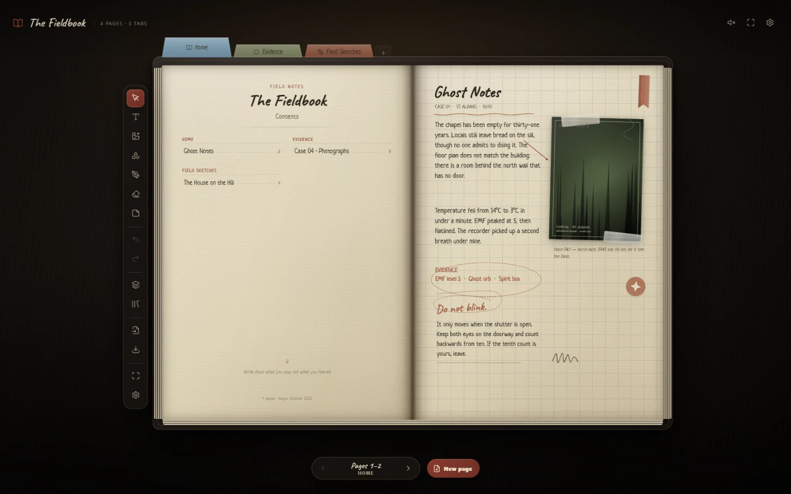
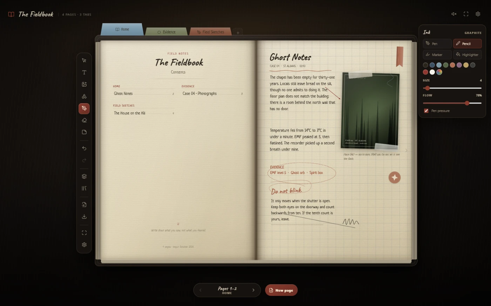
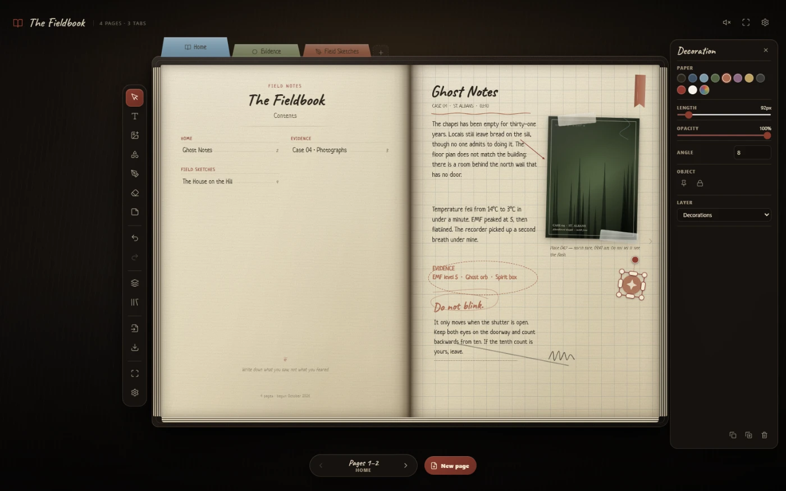
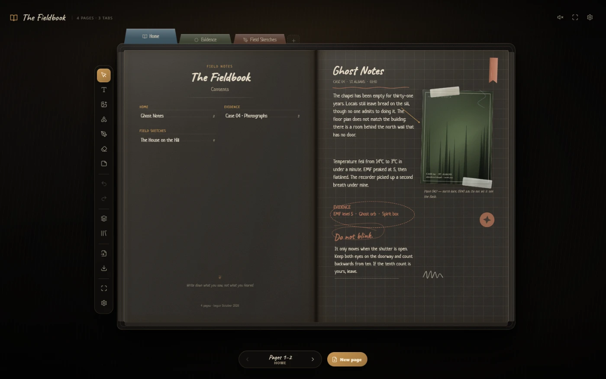
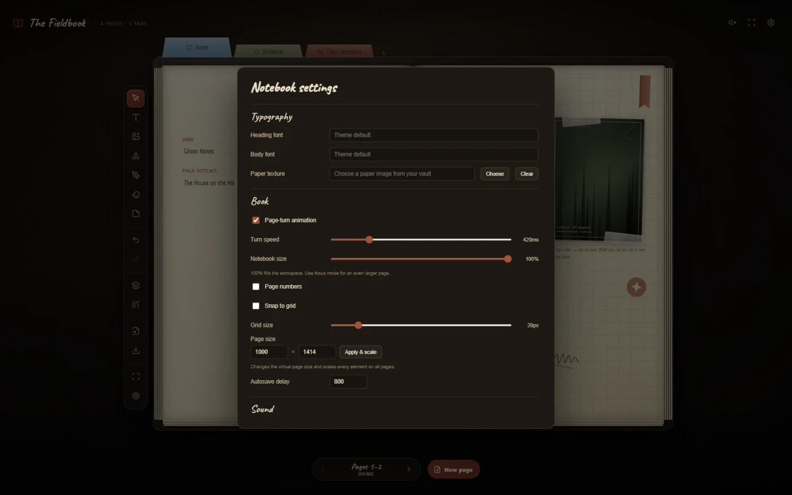
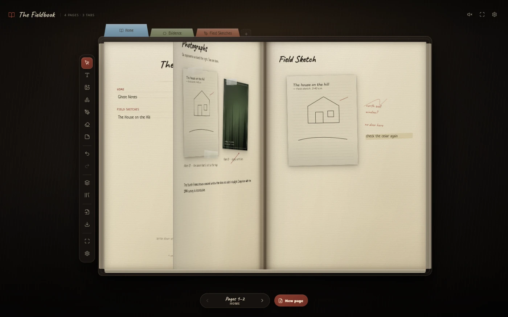

# Fieldbook

**Настоящий бумажный блокнот внутри Obsidian.** Двухстраничный разворот, живое перо, фотографии на скотче, закладки, слои и звук перелистывания.

[English](README.md) · Русский

[](https://github.com/ZekiTRR/FieldBook)
[](https://github.com/ZekiTRR/FieldBook)
[](LICENSE)

## О блокноте

Fieldbook — это не ещё один холст для заметок, а физический блокнот, который лежит на рабочем столе Obsidian. Страницы живут в развороте на две стороны, перелистываются с перспективой и звуком, а рисование, текст, фотографии и декорации ощущаются как работа с бумагой.

Всё хранится локально в вашем хранилище: без облака, без аккаунта, без оплаты и без сетевых запросов во время работы.

## Возможности

- **Книжный разворот.** Две страницы, корешок, обложка и перелистывание с 3D-перспективой. Скорость анимации настраивается, при `prefers-reduced-motion` анимация отключается.
- **Живое письмо.** Перо, карандаш, маркер и выделитель с чувствительностью к нажатию, ластик для целых штрихов, слои для чернил.
- **Выравнивание фигур.** Отдельный переключатель «Straighten shapes» в доке для каждого инструмента: дрожащая линия становится ровной, набросанный круг — эллипсом, а «рамка» — прямоугольником. Работает консервативно: осмысленные изгибы и зарисовки остаются как есть, отключается одним кликом.
- **Настоящая бумага.** Зерно, освещение, сгиб у корешка, линейка, сетка или точки. Можно подставить любую текстуру из хранилища — цвет чернил автоматически подстроится под светлую или тёмную бумагу.
- **Фотографии и мелочи.** Вставка из файла, буфера обмена или перетаскиванием, кадрирование, скотч, фотоуголки, стикеры, закладки, рамки и полосы выделения.
- **Диктофон.** Нажми `R`, кликни, где заметка должна жить, и говори. Запись превращается в полоску бумаги с нарисованным от руки кружком play, чернильной волной из реальных пиков и рукописной длительностью. Тап по кружку — воспроизведение, тап по волне — перемотка, а скотч, фотоуголки или голая бумага выбираются в инспекторе. Уголок тянет всю полоску — до трёх размеров, вместе с кольцом, штрихами, скотчем и почерком, — а боковая грань расширяет только волну.
- **Закладки сверху.** Вкладки-закладки с иконками и цветами (Cream, Ocean, Sage, Rust, Plum, Gold, Charcoal, Rose), перетаскивание для смены порядка.
- **Структура.** Менеджер страниц, корзина, оглавление, перемещение страниц между вкладками.
- **Звук.** Записанное перелистывание, живой луп карандаша по бумаге, тихая печать и отдельные громкости для каждой категории. Любой звук можно заменить своим файлом.
- **Темы и типографика.** Classic Journal, Old Manuscript, Clean Paper, Dark Journal и Field Research; рукописные Caveat и Neucha, а также системные шрифты для заголовков и текста.
- **Размеры.** Формат страницы (A5-подобный по умолчанию) и размер блокнота на экране от 50 до 100% рабочей области.
- **Гибкое хранение.** Отдельные настройки для папки блокнота, папки вложений (фото, вставленные картинки, звуки) и папки экспорта — внутри блокнота или в любом месте хранилища.
- **Экспорт.** Страница в PNG, страница в Markdown, импорт Markdown с разбиением на страницы.
- **Focus mode.** Блокнот на весь экран без панелей Obsidian; выход по `Esc`.

## Скриншоты

| Инструменты рисования | Цвета, материалы и инспектор |
| :---: | :---: |
|  |  |

| Тёмная бумага | Настройки блокнота |
| :---: | :---: |
|  |  |



## Установка

Нужен Obsidian 1.5.0 или новее, десктопная версия.

**Через каталог сообщества (рекомендуется).** Откройте **Settings → Community plugins → Browse**, найдите **Fieldbook**, затем **Install** и **Enable**.

**Вручную.** Скачайте `main.js`, `manifest.json` и `styles.css` из [последнего релиза](https://github.com/ZekiTRR/FieldBook/releases/latest) и положите их в `<vault>/.obsidian/plugins/fieldbook/`, после чего включите плагин в **Settings → Community plugins**.

Откройте блокнот командой `Fieldbook: Open notebook` или через ленту слева.

## Как пользоваться

- `V` — выбор, `T` — текст, `P` — рисование, `E` — ластик, `I` — вставить фото, `R` — диктофон. Горячие клавиши привязаны к физической клавише, поэтому работают и на русской, и на любой другой раскладке. Инструменты живут на левой ленте, палитра и настройки кисти — в доке справа.
- С активным диктофоном один клик по странице начинает запись: полоска сразу рисует живые штрихи и счётчик времени. Тап по красной точке или кнопка в доке сохраняют дубль, `Esc` отменяет его, а на пяти минутах запись останавливается сама.
- Выделенная голосовая заметка играет и встаёт на паузу по `Space`. Тап по чернильной волне перематывает; уголки масштабируют полоску пропорционально, боковые грани расширяют только волну, а ползунок **Size** в инспекторе задаёт масштаб от 100% до 300%.
- Двойной клик по странице создаёт текстовый блок. Фотографии можно перетащить прямо на страницу или вставить из буфера.
- В доке кисти есть два переключателя: «Pen pressure» и «Straighten shapes». Оба сохраняются отдельно для пера, карандаша, маркера и выделителя.
- Правый клик или двойной клик по закладке сверху открывает меню: переименование, **Tab colour**, иконка, добавление страницы. Цвета закладок применяются сразу.
- Кнопка с шестернёй открывает настройки блокнота: тема, шрифты, бумага, размер, звук, скорость перелистывания.
- `Ctrl/Cmd+Z` и `Ctrl/Cmd+Shift+Z` — отмена и повтор. История хранится в памяти вкладки Obsidian.

## Настройки

- **Notebook.** Тема, шрифты заголовков и текста, текстура бумаги.
- **Book.** Анимация и скорость перелистывания, размер блокнота на экране, номера страниц, привязка к сетке, формат страницы, задержка автосохранения.
- **Files.** Папка самого блокнота, папка для вложений (фотографии, голосовые записи в подпапке `audio/`, вставленные изображения, импортированные звуки) и папка экспорта. Значение без ведущего `/` считается относительно папки блокнота (`Media` → `Fieldbook/Media`), значение с `/` — от корня хранилища (`/98 - Cache/Fieldbook`).
- **Sound.** Общий звук, громкость, клавиатурный звук, запись перелистывания и отдельные категории: Page turns, Tabs, Pen & pencil, Photos & tape, Interface.
- **Page.** Фон новой страницы (plain, ruled, grid, dots), оглавление, размер.
- **Tabs.** Цвет и иконка каждой закладки.

## Приватность и файлы

Раскрытия по требованиям [политики разработчиков Obsidian](https://docs.obsidian.md/Developer+policies):

- **Сеть не используется.** Плагин никуда не обращается: никакого бэкенда, проверок обновлений, аналитики и телеметрии. Шрифты, звуки и картинки лежат внутри папки плагина.
- **Аккаунт и оплата не нужны.** Все функции бесплатны.
- **Микрофон используется только во время записи.** Диктофон работает через `navigator.mediaDevices.getUserMedia({ audio: true })` и `MediaRecorder`. Звук пишется ровно пока идёт дубль, который начал ты, кодируется на твоей машине и кладётся в папку вложений блокнота. Никуда ничего не отправляется, микрофон не трогает больше ничего, а при отказе в доступе остальной плагин продолжает работать.
- **Какие файлы создаются — и всё внутри хранилища:** папка блокнота (по умолчанию `Fieldbook/`) с `journal.json`, `pages/*.json` и `.bak`-копиями, папка вложений для фотографий, голосовых записей и импортированных звуков, папка экспорта для Markdown и PNG, а также `data.json` в папке плагина с настройками. Все пути задаются в **Settings → Fieldbook → Files**.
- **Какие файлы читаются:** только те, что вы явно выбрали сами — текстура бумаги, замена записи перелистывания или звука письма, фотографии, которые вы вставляете, перетаскиваете или берёте из буфера.
- **Только десктоп.** Плагину нужны непрерывный захват указателя, данные о силе нажатия и низкая задержка Web Audio, поэтому `isDesktopOnly: true`, и на мобильных он не предлагается.
- **Не является продуктом Obsidian.** Fieldbook — независимый плагин сообщества на открытом API Obsidian.

## Данные на диске

По умолчанию блокнот хранится в папке `Fieldbook/` вашего хранилища:

```text
Fieldbook/
├── journal.json      # вкладки, порядок страниц, настройки
├── pages/            # по одному JSON на страницу
├── attachments/      # фотографии, голосовые записи в audio/, импортированные звуки
└── exports/          # Markdown и PNG
```

Каждое сохранение оставляет рядом `.bak`-копию; если JSON не читается, Fieldbook восстанавливает его из резервной копии. В настройках можно выбрать как папку самого блокнота, так и отдельные папки для вложений и экспорта — внутри блокнота или в любом месте хранилища. Уже добавленные фотографии остаются на своих местах.

## Разработка

```bash
npm ci
npm run dev       # watch-сборка
npm run build     # typecheck + production
npm run typecheck
```

Сборка кладёт `main.js` и `styles.css` в корень плагина. Локальные `data.json`, `node_modules` и карты исходников в репозиторий не попадают.

Пуш semver-тега вида `1.0.1` запускает [release-воркфлоу](.github/workflows/release.yml): он собирает плагин и создаёт черновик релиза на GitHub с `main.js`, `manifest.json` и `styles.css`. Тег должен совпадать с `version` в `manifest.json` — Obsidian ставит плагин именно из релиза с этим тегом.

Плагин написан на TypeScript и использует только API Obsidian, Canvas 2D и Web Audio.

## Благодарности

- Звук карандаша: [Pencil #1](https://bigsoundbank.com/pencil-s0221.html) by Joseph SARDIN, BigSoundBank, CC0.
- Звук перелистывания: записан и опубликован автором плагина.
- Шрифты: [Caveat](https://fonts.google.com/specimen/Caveat) и [Neucha](https://fonts.google.com/specimen/Neucha), SIL Open Font License 1.1. Тексты лицензий лежат в `assets/fonts/`.
- Сделано на [Obsidian API](https://docs.obsidian.md/). Проект не связан с Obsidian.

## Лицензия

MIT. См. [LICENSE](LICENSE).
